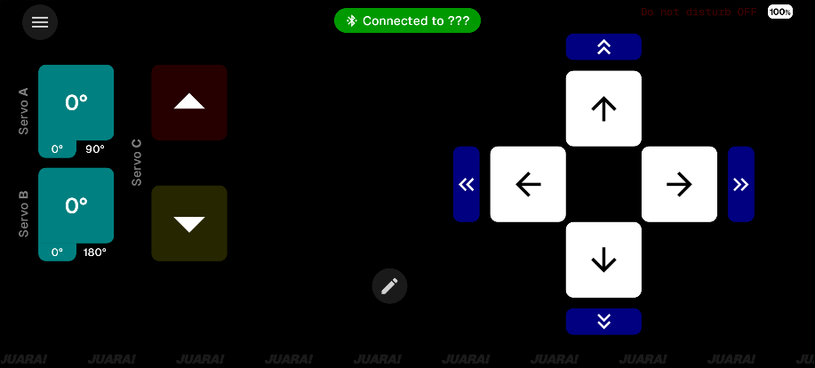

  

# JUAR4M

An Android RC Car controller for the "Gigo Maker Control Box" via Bluetooth.

This app was developed for the GreenMech Robot for Mission (R4M) Classic competition. It prioritizes low latency, connection reliability, and precise motor control.

The logo (designed by Jo) features a sabertooth, symbolizing precision and decisive action.

## Firmware (Arduino Code)

> [!IMPORTANT]
> This app requires the companion JUAR4M firmware, which handles the Bluetooth protocol, pin mapping, and safety logic.
>
> **JUAR4M Arduino Repository**: [1rens1/juar4m-arduino](https://github.com/1rens1/juar4m-arduino)

## Requirements

- Android 10 ("Q") (API level 29) or greater
- Bluetooth connectivity & permissions

## How to Install

> [!NOTE]
> This app is Android only

1. Go to the [Actions](https://github.com/1rens1/juar4m/actions) tab and click on the latest successfull deployment (green check)
2. Scroll down and download the `Signed-APK.zip`
3. Extract the zip file and install the APK

## Features

### Connectivity & Safety

- **Auto-Connect:** Automatically connects to the last used device on launch and reconnects if the link is dropped.
- **Watchdog Protocol:**
	- Sends continuous movement commands (Forward, Backward, Left, or Right).
	- If the Arduino does not receive a command within the defined timeout, it automatically stops all motors to prevent runaway robots. (Timeout is defined in the Arduino repository)

### Controls

- **D-Pad:** Touch-and-drag interface for primary movement.
- **Nudge:** Dedicated buttons for short, precise movement bursts.
- **Servos:**
  - **Servo A & B:** Toggle buttons with configurable angle ranges via sliders.
  - **Servo C:** Dedicated controls for continuous rotation (Up/Down/Stop).

### Utilities

- **Competition Stopwatch:**
  - Auto-starts on first input detection.
  - Tracks Personal Best (PB).
  - Live display of time difference (+/-) against PB.
- **Feedback:** Haptic feedback (vibrations) on button presses.
- **Status Indicators:** Phone battery percentage, Do Not Disturb (DND) status, and connection state.
- **Visuals:** Animated marquee background (can be toggled for battery saving).

## Technologies and Assets Used

- Android Studio
- Kotlin
- Jetpack Compose (Material3)
- Datastore
- [Geist](https://fonts.google.com/specimen/Geist) and [Geist Mono](https://fonts.google.com/specimen/Geist+Mono) by Vercel from Google Fonts (SIL Open Font License, Version 1.1)

## Generative AI

Some Generative AI was used in the development of this project, with all code subject to manual review and testing.
